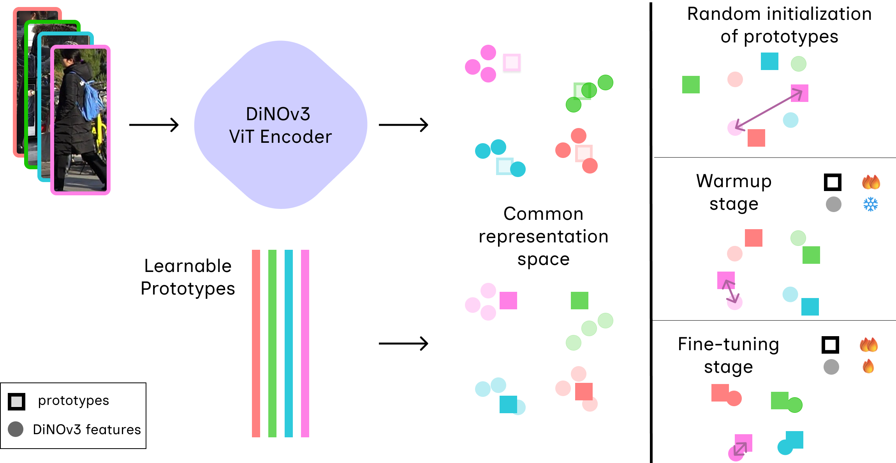
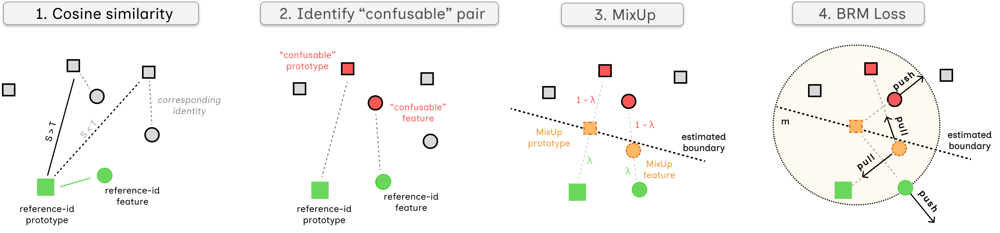

<div align="center">

# PBR-ReID

### Learning Discriminative Prototypes via Boundary Repulsion MixUp for Object Re-Identification

**Athena Psalta · Vasileios Tsironis · Konstantinos Karantzalos**

National Technical University of Athens

[](https://wacv.thecvf.com/)
[](LICENSE)



</div>

🎉 **Accepted at WACV 2027!** This repository is the official reference implementation.

**PBR-ReID** is a prototype-based object re-identification framework built on a
DINOv3 backbone. Its core component, **Boundary Repulsion MixUp (BRM)**, is a
geometry-aware regularizer. BRM finds pairs of identities the model confuses,
builds an explicit boundary proxy between them and pushes their features away
from it. The same model works for both person and vehicle re-ID. At test time
the prototypes are dropped and retrieval is plain cosine nearest-neighbour
search, with no re-ranking and no camera embeddings.

## ✨ Highlights

- **Learnable identity prototypes:** each identity has one prototype that is
  trained jointly with the encoder. The prototype similarity matrix **S** shows
  which identity pairs are confusable at every training step.
- **Boundary Repulsion MixUp:** MixUp between a confusable pair estimates
  the decision boundary between them. BRM pulls the mixed samples toward that
  boundary and pushes the real features away from it. An adaptive margin keeps
  the prototypes apart.
- **Stable two-stage training:** a prototype warmup with a frozen backbone,
  followed by EMA-stabilized joint fine-tuning with dual learning rates.
- **Simple inference:** cosine nearest-neighbour retrieval on DINOv3
  features, with no re-ranking, camera embeddings or prototypes needed at test
  time.

## 🔍 How it works

<div align="center">

</div>

1. **Cosine similarity:** each feature is compared against all identity
   prototypes.
2. **Confusable pair:** a different identity's prototype that scores above the
   threshold τ is marked as confusable with the reference identity.
3. **MixUp:** mixing the two prototypes, and the two features, with weight λ
   gives a proxy for the boundary between the identities.
4. **BRM loss:** the mixed samples are pulled toward the estimated boundary,
   and the real features are pushed out of a margin *m* around it.

The full objective (Eq. 1) combines a feature-prototype triplet loss
**L_fpt**, a batch-hard triplet loss **L_bht**, a Fréchet-mean center loss
**L_cen**, a unit-norm regularizer **L_norm** and **L_BRM**.

## 📊 Results at a glance

DINOv3 ViT-B/16, single query, **no re-ranking**. All values are in %.

### Person Re-Identification

| Dataset | mAP | Rank-1 |
|:--|:--:|:--:|
| Market-1501 | **94.0** | **97.1** |
| DukeMTMC-reID | **86.1** | **93.1** |
| MSMT17 | **79.7** | **91.2** |
| CUHK03-NP (detected) | **88.4** | **89.8** |
| IUST | **55.2** | **63.8** |

### Vehicle Re-Identification

<table>
  <tr><th rowspan="2">Model</th><th colspan="2">VeRi-776</th><th colspan="2">VehicleID (large)</th></tr>
  <tr><th>mAP</th><th>Rank-1</th><th>Rank-1</th><th>Rank-5</th></tr>
  <tr><td>PBR-ReID</td><td align="center"><b>88.0</b></td><td align="center"><b>98.1</b></td><td align="center"><b>90.2</b></td><td align="center"><b>96.0</b></td></tr>
</table>

### Different backbones

Every backbone is trained and evaluated with the same settings.

<table>
  <tr><th rowspan="2">Backbone</th><th rowspan="2">#Params</th><th colspan="2">Market-1501</th><th colspan="2">DukeMTMC-reID</th></tr>
  <tr><th>mAP</th><th>Rank-1</th><th>mAP</th><th>Rank-1</th></tr>
  <tr><td>ViT-B/16 (ImageNet)</td><td align="center">86M</td><td align="center">92.2</td><td align="center">96.3</td><td align="center">84.1</td><td align="center">91.8</td></tr>
  <tr><td>CLIP ViT-B/16</td><td align="center">86M</td><td align="center">93.4</td><td align="center">96.6</td><td align="center">85.4</td><td align="center">92.7</td></tr>
  <tr><td>DINOv2 ViT-B/14</td><td align="center">86M</td><td align="center">93.7</td><td align="center">96.7</td><td align="center">85.9</td><td align="center">92.9</td></tr>
  <tr><td><b>DINOv3 ViT-B/16 (default)</b></td><td align="center">86M</td><td align="center"><b>94.0</b></td><td align="center"><b>97.1</b></td><td align="center"><b>86.1</b></td><td align="center"><b>93.1</b></td></tr>
  <tr><td>DINOv3 ViT-L/16</td><td align="center">300M</td><td align="center">94.8</td><td align="center">97.2</td><td align="center">89.7</td><td align="center">94.6</td></tr>
  <tr><td>DINOv3 ViT-H+/16</td><td align="center">840M</td><td align="center">95.3</td><td align="center">97.4</td><td align="center">90.8</td><td align="center">95.1</td></tr>
</table>

The full tables are in the paper.

## 📑 Contents

1. [Installation](#1-installation)
2. [Weights and datasets](#2-weights-and-datasets)
3. [Training and evaluation](#3-training-and-evaluation)
4. [Reproducing the paper](#4-reproducing-the-paper)
5. [Repository layout](#5-repository-layout)
6. [Citation](#-citation)

## 1. Installation

```bash
git clone --recursive https://github.com/psaltaath/pbr-reid.git && cd pbr-reid
uv sync                      # or: pip install -e . (Python >= 3.12, PyTorch >= 2.8)
```

## 2. Weights and datasets

**DINOv3 weights.** The backbone code is the `facebookresearch/dinov3` submodule
in `third_party/dinov3`. Meta gates the pretrained checkpoints, so download them
from https://github.com/facebookresearch/dinov3 into `weights/dinov3/` and keep
the official filenames, e.g. `dinov3_vitb16_pretrain_lvd1689m-73cec8be.pth`. To
use a different folder, set `model.dinov3_weights_dir` or
`export PBR_DINOV3_WEIGHTS=/path`.

**Other encoders (Table 3).** `uv run scripts/download_backbones.py` downloads
the CLIP ViT-B/16, ImageNet ViT-B/16 and DINOv2 ViT-B/14 weights into
`weights/backbones/`.

**Datasets.** Place them under `data/`, or `export PBR_DATA_ROOT=/path`, using
the folder names listed in [docs/DATASETS.md](docs/DATASETS.md).

## 3. Training and evaluation

```bash
uv run train.py market1501                 # paper recipe; logs + checkpoints in runs/market1501
uv run train.py veri                       # vehicles use the 192x384 geometry (configs/datasets/veri.yaml)
uv run train.py market1501 vitl16          # stack any configs/**.yaml by name
uv run train.py dukemtmc -f configs/ablations/losses/l5_mixup.yaml --system.seed 123
uv run eval.py market1501 --checkpoint runs/market1501/latest.pth [--rerank]
```

Training Market-1501 with ViT-B/16 takes about a day on one RTX 4090.

<details>
<summary><b>Paper recipe (Sec. 4.1)</b></summary>

`configs/base.yaml` holds these settings:

- **Batches and inputs:** 8 identities × 4 instances, 384×192 inputs.
- **Schedule:** 200 epochs, including 10 warmup epochs.
- **Optimizer:** AdamW with an encoder LR of 1e-5 → 1e-7 (cosine) and a
  prototype LR of 1e-1 (step 15), plus EMA 0.999.
- **Loss weights:** λ_fpt = λ_bht = 1, λ_cen = 0.5, λ_norm = 0.005,
  λ_BRM = 0.4.
- **BRM:** τ = 0.7, α = 0.4, m_BRM = 0.5, β = 0.7, γ_sep = 1.5.

[docs/CONFIG.md](docs/CONFIG.md) maps every setting to its symbol in the paper.

</details>

## 4. Reproducing the paper

Every ablation in the paper is an override file under `configs/ablations/`,
generated by `configs/ablations/generate.py`.
[docs/REPRODUCE.md](docs/REPRODUCE.md) lists the command behind each table and
figure, and `scripts/reproduce.sh` runs them all. The figure scripts are in
`tools/`: the retrieval comparison, the confusable-pair KDE and the prototype
t-SNE.

## 5. Repository layout

```
train.py / eval.py        entry points
configs/                  base.yaml (paper recipe), datasets/, backbones/, ablations/
config/                   typed configuration (dataclasses + YAML + CLI overrides)
datasets/                 Market-1501, DukeMTMC, MSMT17, CUHK03-NP, IUST, VeRi-776, VehicleID loaders + PK sampler
models/                   DINOv3 / DINOv2 / CLIP / ImageNet encoders, PrototypeReID
losses/                   L_fpt, L_cen, L_norm, L_bht, MixUp + BRM, adaptive-margin separation, Table 4 heads
training/                 two-stage Trainer, optimizer factories, data pipeline
evaluation/               mAP / CMC, k-reciprocal re-ranking
tools/                    figure scripts (retrieval comparison, confusable-pair KDE, prototype t-SNE)
scripts/                  download_backbones.py, reproduce.sh
tests/                    CPU unit tests (uv run pytest)
third_party/dinov3        DINOv3 submodule
```

## 📝 Citation

```bibtex
@inproceedings{psalta2027pbrreid,
  title     = {Learning Discriminative Prototypes via Boundary Repulsion MixUp for Object Re-Identification},
  author    = {Psalta, Athena and Tsironis, Vasileios and Karantzalos, Konstantinos},
  booktitle = {Proceedings of the IEEE/CVF Winter Conference on Applications of Computer Vision (WACV)},
  year      = {2027}
}
```

## 🙏 Acknowledgements

This work builds on [DINOv3](https://github.com/facebookresearch/dinov3) (Meta,
DINOv3 License). 

The dataset loaders follow
[TransReID](https://github.com/damo-cv/TransReID) and
[CLIP-ReID](https://github.com/Syliz517/CLIP-ReID), and the re-ranking follows
Zhong et al. (CVPR 2017).

## 📄 License

The code is released under the MIT License. See [LICENSE](LICENSE) and [NOTICE](NOTICE).
